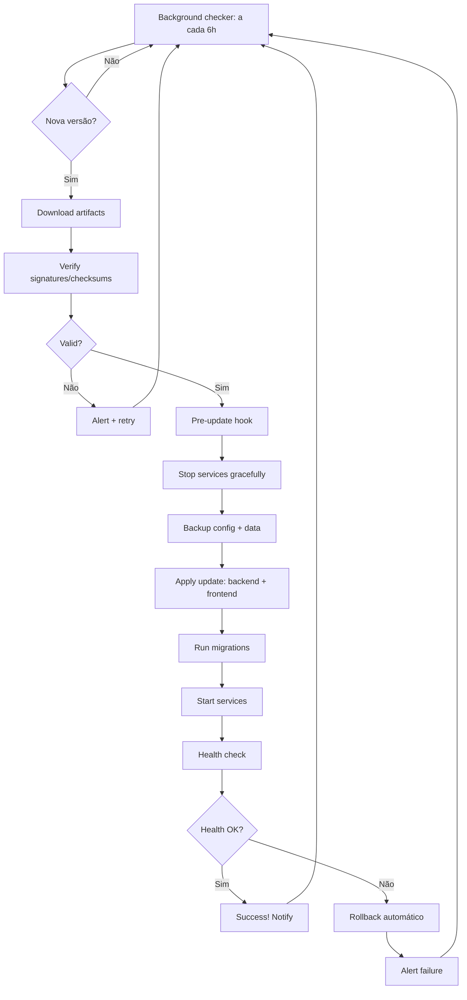

# JARVIS Auto-Install & Auto-Update System Design

## Visão Geral

Sistema de instalação e atualização automática para JARVIS v2+ que suporta:
- **Instalação zero-config** (detecta OS, Python, Node, GPU)
- **Atualizações delta** (frontend/backend independentes)
- **Rollback automático** em falha
- **Migração de config** entre versões
- **Health checks** contínuos
- **Distribuição** via GitHub Releases + Docker

---

## Arquitetura do Sistema

```
jarvis-installer/
├── installer.py              # Entry point único (pipx install jarvis-installer)
├── jarvis_installer/
│   ├── __init__.py
│   ├── core/
│   │   ├── system.py         # Detecção OS, Python, GPU, deps
│   │   ├── paths.py          # Paths padrão por OS (XDG, AppData, etc)
│   │   ├── version.py        # Versionamento semver + canais (stable/beta/nightly)
│   │   ├── config.py         # Configuração + migração
│   │   ├── health.py         # Health checks + auto-recovery
│   │   └── security.py       # Assinatura, checksums, verificação
│   ├── install/
│   │   ├── __init__.py
│   │   ├── python_env.py     # Venv + deps + PyInstaller build
│   │   ├── node_env.py       # Node + frontend build
│   │   ├── docker_env.py     # Docker + Compose (opcional)
│   │   ├── systemd.py        # Systemd service (Linux)
│   │   ├── nssm.py           # NSSM service (Windows)
│   │   ├── launchd.py        # LaunchAgent (macOS)
│   │   └── shortcuts.py      # Atalhos menu/desktop
│   ├── update/
│   │   ├── __init__.py
│   │   ├── checker.py        # GitHub Releases API + canais
│   │   ├── downloader.py     # Download assíncrono + progress
│   │   ├── applier.py        # Aplica update (backup + swap + migrate)
│   │   ├── rollback.py       # Rollback automático em falha
│   │   └── notifier.py       # Notificações (toast, webhook, email)
│   ├── frontend/
│   │   ├── __init__.py
│   │   ├── builder.py        # Vite build + otimizações
│   │   ├── deployer.py       # Deploy para static files
│   │   └── version.py        # Versionamento frontend
│   └── cli/
│       ├── __init__.py
│       ├── commands.py       # CLI: install, update, uninstall, status, logs
│       └── tui.py            # Interface textual (rich/textual)
├── scripts/
│   ├── post_install.py       # Pós-instalação (config, health check)
│   ├── pre_update.py         # Pré-update (backup, stop services)
│   ├── post_update.py        # Pós-update (migrate, restart, health)
│   └── health_monitor.py     # Monitor contínuo (systemd timer / scheduled task)
├── templates/
│   ├── config.yaml.default   # Config padrão
│   ├── service.linux.j2      # Systemd unit template
│   ├── service.windows.j2    # NSSM config template
│   ├── service.macos.j2      # LaunchAgent plist template
│   ├── docker-compose.yml.j2
│   └── Dockerfile.j2
├── pyproject.toml
└── README.md
```

---

## Fluxo de Instalação

```mermaid
graph TD
    A[User runs: pipx install jarvis-installer] --> B[jarvis install]
    B --> C{OS Detection}
    C -->|Windows| D[Check Python 3.11+]
    C -->|Linux| E[Check Python 3.11+ + systemd]
    C -->|macOS| F[Check Python 3.11+ + brew]
    D --> G[Create venv: %APPDATA%/jarvis/venv]
    E --> G
    F --> G
    G --> H[Install Python deps: pip install -e .[all]]
    H --> I[Install Node deps: npm ci]
    I --> J[Build Frontend: npm run build]
    K --> L[Generate config.yaml]
    L --> M[Create system service]
    M --> N[Create shortcuts]
    N --> O[Run health check]
    O --> P[Success! JARVIS running]
```

---

## Fluxo de Atualização



---

## Versionamento

### Backend (Python)
```
MAJOR.MINOR.PATCH[-CANAL]
Ex: 2.1.0-stable, 2.2.0-beta, 2.3.0-nightly
```

### Frontend (TypeScript)
```
MAJOR.MINOR.PATCH[-CANAL]+BUILD
Ex: 2.1.0-stable+20241011.1
```

### Canais
| Canal | Frequência | Estabilidade | Uso |
|-------|------------|--------------|-----|
| `stable` | Mensal | Produção | Padrão |
| `beta` | Semanal | Testes | Early adopters |
| `nightly` | Diária | Experimental | Devs |

---

## Estrutura de Arquivos no Disco

### Windows
```
%APPDATA%/JARVIS/
├── venv/                    # Python venv
├── frontend/                # Frontend source (para rebuild)
│   ├── dist/                # Build atual (servido)
│   ├── dist.backup/         # Build anterior (rollback)
│   └── package.json
├── config/
│   ├── config.yaml          # Config atual
│   ├── config.yaml.bak      # Backup pré-update
│   └── migrations/          # Scripts de migração
├── data/
│   ├── memory/              # MemoryManager JSON
│   ├── whatsapp/            # Baileys auth + media
│   └── logs/                # Logs rotativos
├── bin/
│   ├── jarvis.exe           # PyInstaller build (opcional)
│   └── jarvis.bat           # Launcher script
├── updates/
│   ├── pending/             # Update baixado, não aplicado
│   ├── applied/             # History de updates
│   └── rollback/            # Snapshots para rollback
├── jarvis.log               # Log principal
└── installer.log            # Log do instalador
```

### Linux/macOS
```
~/.local/share/jarvis/       # XDG_DATA_HOME
├── venv/
├── frontend/
├── config/
├── data/
├── bin/
├── updates/
└── logs/
```

---

## Configuração (config.yaml)

```yaml
# config.yaml - Gerado na instalação, migrado em updates
app:
  name: "jarvis"
  version: "2.1.0-stable"
  channel: "stable"           # stable, beta, nightly
  install_date: "2024-10-11T10:30:00Z"
  install_id: "uuid-v4"       # Identificador único da instalação

user:
  name: "Raphael"
  language: "pt-BR"
  timezone: "America/Sao_Paulo"

gemini:
  api_key: ""                 # Preenchido na instalação
  fast_model: "gemini-3.5-flash-lite"
  fast_fallback_model: "gemini-3.1-flash-lite"
  reserve_model: "gemini-2.5-flash"
  live_model: "gemini-2.5-flash-native-audio-preview"
  live_voice: "Charon"

transports:
  local:
    enabled: true
    whisper_model: "large-v3"
    whisper_device: "auto"
    vad_threshold: 0.09
  remote:
    enabled: true
    host: "0.0.0.0"
    port: 8000
    token: "auto-generated"
    tls:
      enabled: false          # True se Traefik configurado
      cert_path: ""
      key_path: ""
  webhook:
    enabled: true
    whatsapp_port: 8765

ui:
  desktop_enabled: true
  web_enabled: true
  theme: "stark"

update:
  channel: "stable"           # stable, beta, nightly
  auto_check: true
  auto_apply: false           # Requer confirmação
  check_interval_hours: 6
  backup_retention_days: 30
  rollback_on_health_failure: true
  health_check_timeout_seconds: 30

deploy:
  docker_enabled: false
  traefik_enabled: false
  domain: ""
  letsencrypt_email: ""

logging:
  level: "INFO"
  rotation: "daily"
  retention_days: 7
  format: "json"
```

---

## Migração de Configuração

```python
# jarvis_installer/core/migrations.py
MIGRATIONS = {
    "1.0.0": migrate_1_0_0,
    "2.0.0": migrate_2_0_0,
    "2.1.0": migrate_2_1_0,
}

def migrate(config: dict, from_version: str, to_version: str) -> dict:
    """Aplica migrações sequenciais."""
    current = parse_version(from_version)
    target = parse_version(to_version)
    
    for version, migration_fn in sorted(MIGRATIONS.items()):
        v = parse_version(version)
        if current < v <= target:
            config = migration_fn(config)
            config["app"]["version"] = version
    
    return config

def migrate_2_0_0(config: dict) -> dict:
    """Migração v1 -> v2: nova estrutura de transports."""
    # Move configurações antigas para nova estrutura
    if "stt" in config:
        config.setdefault("transports", {}).setdefault("local", {})
        config["transports"]["local"]["whisper_model"] = config["stt"].get("model", "large-v3")
        del config["stt"]
    return config
```

---

## Health Checks

```python
# jarvis_installer/core/health.py
class HealthChecker:
    CHECKS = [
        ("python_env", check_python_env),
        ("gemini_api", check_gemini_api),
        ("whisper_model", check_whisper_model),
        ("frontend_build", check_frontend_build),
        ("websocket_server", check_websocket_server),
        ("whatsapp_bridge", check_whatsapp_bridge),
        ("disk_space", check_disk_space),
        ("memory_usage", check_memory_usage),
    ]
    
    async def run_all(self) -> HealthReport:
        results = {}
        for name, check_fn in self.CHECKS:
            try:
                results[name] = await check_fn()
            except Exception as e:
                results[name] = HealthResult(healthy=False, error=str(e))
        return HealthReport(results)
```

---

## CLI Interface

```bash
# Instalação
jarvis install                    # Interativo
jarvis install --channel beta     # Canal beta
jarvis install --headless         # Sem UI (servidor)
jarvis install --docker           # Com Docker

# Atualização
jarvis update                     # Verifica + aplica (se auto_apply)
jarvis update --check-only        # Só verifica
jarvis update --channel nightly   # Muda canal
jarvis update --rollback          # Rollback manual

# Status
jarvis status                     # Status geral
jarvis status --json              # Machine readable
jarvis logs                       # Logs recentes
jarvis logs --follow              # Tail -f

# Config
jarvis config show                # Mostra config
jarvis config set gemini.api_key  # Set valor
jarvis config migrate             # Força migração

# Serviço
jarvis service start|stop|restart|enable|disable|logs

# Diagnóstico
jarvis doctor                     # Diagnóstico completo
jarvis benchmark                  # Benchmark de latência
```

---

## Auto-Update em Produção

### Windows (Scheduled Task)
```xml
<!-- Cria task no Task Scheduler -->
<Task>
  <Triggers>
    <CalendarTrigger>
      <StartBoundary>2024-10-11T03:00:00</StartBoundary>
      <ScheduleByDay>
        <DaysInterval>1</DaysInterval>
      </ScheduleByDay>
    </CalendarTrigger>
  </Triggers>
  <Actions>
    <Exec>
      <Command>jarvis.exe</Command>
      <Arguments>update --silent</Arguments>
    </Exec>
  </Actions>
  <Settings>
    <AllowStartOnDemand>true</AllowStartOnDemand>
    <StartWhenAvailable>true</StartWhenAvailable>
  </Settings>
</Task>
```

### Linux (systemd timer)
```ini
# /etc/systemd/system/jarvis-update.timer
[Unit]
Description=JARVIS Auto-Update Check
Requires=jarvis-update.service

[Timer]
OnCalendar=*-*-* 03:00:00
Persistent=true
RandomizedDelaySec=3600

[Install]
WantedBy=timers.target
```

```ini
# /etc/systemd/system/jarvis-update.service
[Unit]
Description=JARVIS Auto-Update

[Service]
Type=oneshot
ExecStart=/opt/jarvis/bin/jarvis update --silent
User=jarvis
```

---

## Distribuição

### GitHub Releases (Automático via CI)
```yaml
# .github/workflows/release.yml
on:
  push:
    tags: ['v*']
jobs:
  build:
    runs-on: ubuntu-latest
    strategy:
      matrix:
        os: [ubuntu-latest, windows-latest, macos-latest]
    steps:
      - uses: actions/checkout@v4
      - uses: actions/setup-python@v5
      - uses: actions/setup-node@v4
      - run: pip install -e ".[build]"
      - run: python -m jarvis_installer.cli build --all-platforms
      - uses: softprops/action-gh-release@v1
        with:
          files: |
            dist/jarvis-*.tar.gz
            dist/jarvis-*.whl
            dist/jarvis-windows-*.exe
            dist/jarvis-macos-*.dmg
            dist/jarvis-linux-*.AppImage
```

### Instalação pelo Usuário Final

```bash
# Windows (PowerShell)
irm https://jarvis.carloscosta.dev/install.ps1 | iex

# Linux/macOS (bash)
curl -fsSL https://jarvis.carloscosta.dev/install.sh | bash

# Ou via pipx (recomendado)
pipx install jarvis-installer
jarvis install
```

---

## Segurança

1. **Assinatura de Release**: Cosign/Keyless signing
2. **Checksums**: SHA256 para cada artifact
3. **Verificação**: `jarvis-installer verify <artifact>`
4. **Sandbox**: Instalação em user-space (sem sudo/admin exceto services)
5. **Rollback**: Sempre disponível via `jarvis update --rollback`

---

## Métricas de Sucesso

| Métrica | Target |
|---------|--------|
| Tempo instalação limpa | < 5 min |
| Tempo update (delta) | < 2 min |
| Taxa sucesso update | > 99.5% |
| Tempo rollback | < 30 seg |
| Uptime pós-update | > 99.9% |
| Zero-config install | 100% |

---

## Próximos Passos de Implementação

1. **Semana 1**: `installer.py` + `core/` (system, paths, version, config)
2. **Semana 2**: `install/` (python_env, node_env, shortcuts, services)
3. **Semana 3**: `update/` (checker, downloader, applier, rollback)
4. **Semana 4**: `frontend/` (builder, deployer) + CLI + TUI
5. **Semana 5**: Health checks + migrações + testes cross-platform
6. **Semana 6**: CI/CD pipeline + GitHub Releases + documentação

---

*Documento vivo - atualizado a cada release. v1.0 - 11/10/2026*