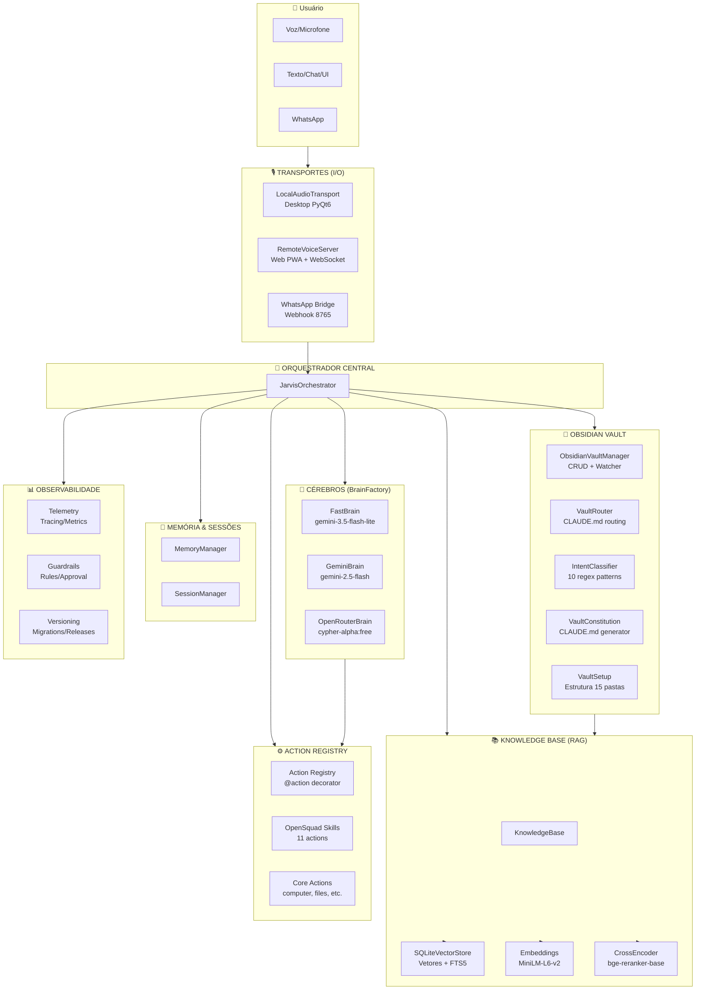
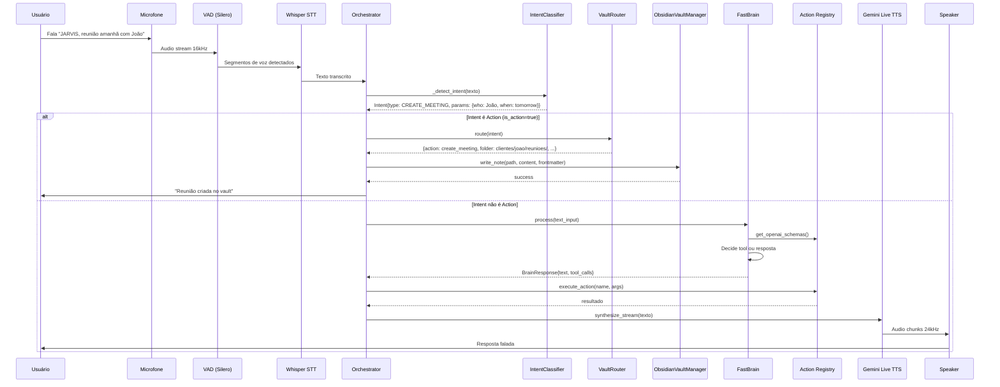
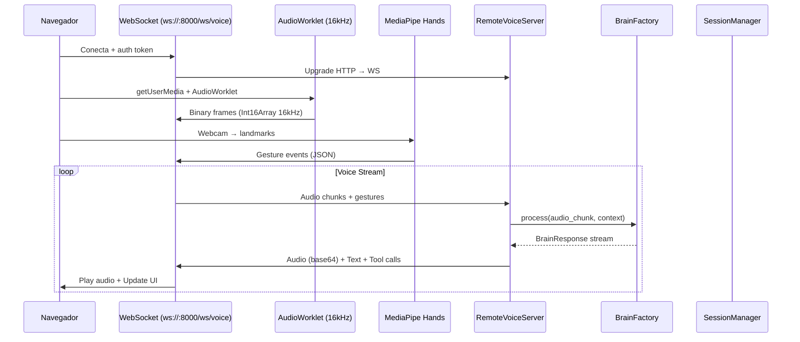
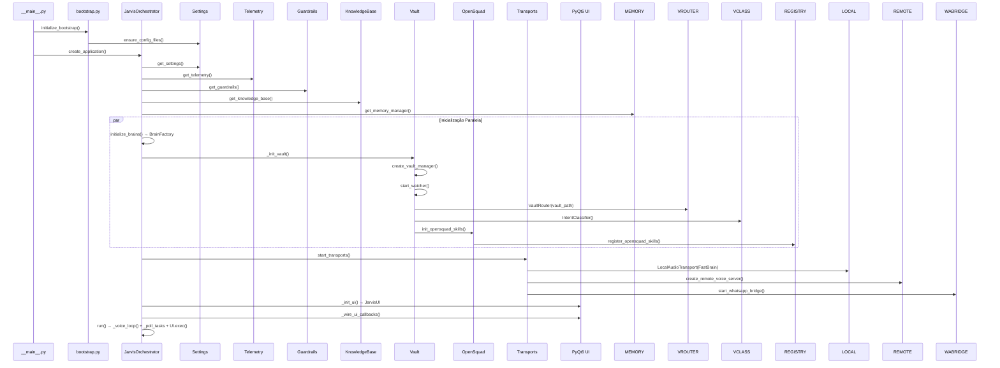
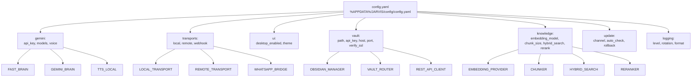
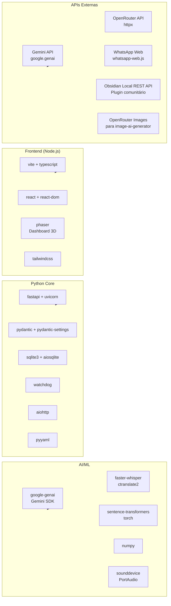

# JARVIS CyberBot - Arquitetura Completa (Flowchart + Dependências)

## 1. Visão Geral - Camadas do Sistema



---

## 2. Fluxo de Dados - Voice Loop (Desktop)



---

## 3. Fluxo de Dados - Web PWA (Remoto)



---

## 4. Dependências - BrainFactory (Cadeia de Fallback)

```mermaid
graph TD
    BF[BrainFactory<br/>src/jarvis/core/brain/__init__.py]
    
    BF -->|get_fast_brain()| FAST[FastBrain<br/>src/jarvis/core/brain/fast.py]
    BF -->|get_gemini_brain()| GEMINI[GeminiBrain<br/>src/jarvis/core/brain/gemini.py]
    BF -->|get_openrouter_brain()| OPENR[OpenRouterBrain<br/>src/jarvis/core/brain/openrouter.py]
    
    FAST -->|usa| GEMINI_API[Gemini API Key]
    FAST -->|usa| ACTION_REG[Action Registry]
    FAST -->|usa| MEMORY[MemoryManager]
    
    GEMINI -->|usa| GEMINI_API
    GEMINI -->|usa| ACTION_REG
    GEMINI -->|function calling nativo| GEMINI_TOOLS[Gemini Function Calling]
    
    OPENR -->|usa| OPENROUTER_KEY[OpenRouter API Key]
    OPENR -->|usa| ACTION_REG
    OPENR -->|HTTP| OPENROUTER_API[openrouter.ai/api/v1]
    
    %% Fallback chain
    FAST -.->|falha: 429, 503, 404, timeout| GEMINI
    GEMINI -.->|falha| OPENR
    
    classDef primary fill:#e3f2fd,stroke:#1976d2,stroke-width:2px;
    classDef fallback fill:#fff3e0,stroke:#f57c00,stroke-width:2px;
    classDef external fill:#fce4ec,stroke:#c2185b,stroke-width:2px;
    
    class FAST primary;
    class GEMINI fallback;
    class OPENR fallback;
    class GEMINI_API,OPENROUTER_KEY external;
```

---

## 5. Vault → Knowledge Base Sync (One-Way)

```mermaid
graph LR
    subgraph VAULT["Obsidian Vault (Source of Truth)"]
        MD[(.md files<br/>15 pastas)]
        WATCHER[Watchdog Watcher<br/>FileSystemEventHandler]
        REST[Local REST API<br/>Porta 27124]
    end
    
    subgraph SYNC["Sync Pipeline"]
        EVENT[VaultFileEvent<br/>CREATED/MODIFIED/DELETED]
        QUEUE[asyncio.Queue<br/>Debounce 500ms]
        PROCESS[_sync_event_to_kb()]
    end
    
    subgraph KB["Knowledge Base (Search Engine)"]
        CHUNKER[Chunker<br/>Recursive 512/50]
        EMBED_PROV[EmbeddingProvider<br/>MiniLM-L6-v2]
        VECTOR_DB[(SQLiteVectorStore<br/>vectors.db)]
        FTS5[FTS5 BM25 Index<br/>chunks_fts]
    end
    
    MD -->|watchdog| WATCHER
    WATCHER -->|VaultFileEvent| EVENT
    REST -->|CRUD| MD
    EVENT --> QUEUE
    QUEUE --> PROCESS
    PROCESS -->|add_file()| KB
    KB --> CHUNKER
    CHUNKER --> EMBED_PROV
    EMBED_PROV --> VECTOR_DB
    CHUNKER --> FTS5
    
    %% Search flow
    QUERY[Query] -->|hybrid_search()| VECTOR_DB
    QUERY -->|keyword search| FTS5
    VECTOR_DB -->|vector results| RRF[RRF Fusion k=60]
    FTS5 -->|bm25 results| RRF
    RRF -->|top-k| RERANK[CrossEncoder Reranker]
    RERANK -->|final results| USER
```

---

## 6. Action Registry - Arquitetura de Tools

```mermaid
graph TB
    subgraph DECORATOR["@action Decorator"]
        DEC[@action<br/>namespace, description]
        SIG[inspect.signature]
        HINTS[get_type_hints]
        PYDANTIC[create_model<br/>ArgsModel]
        SCHEMA[model_json_schema]
    end
    
    subgraph REGISTRY["_action_registry dict"]
        CORE[Core Actions<br/>namespace: computer, files, etc.]
        OPENSQ[OpenSquad Skills<br/>namespace: opensquad]
    end
    
    subgraph EXECUTION["execute_action()"]
        LOOKUP[_action_registry.get(name)]
        INJECT[Inject session/context]
        CALL[func(**kwargs)]
    end
    
    subgraph BRAIN_INTEGRATION["Brain Integration"]
        GET_SCHEMAS[get_openai_schemas()<br/>→ OpenAI function calling format]
        FAST_BRAIN[FastBrain<br/>_regras() + _limpar()]
        GEMINI_BRAIN[GeminiBrain<br/>_desembrulhar() + function_declarations]
        OPENR_BRAIN[OpenRouterBrain<br/>tools array]
    end
    
    DEC --> SIG
    SIG --> HINTS
    HINTS --> PYDANTIC
    PYDANTIC --> SCHEMA
    SCHEMA --> REGISTRY
    
    REGISTRY --> CORE
    REGISTRY --> OPENSQ
    
    REGISTRY --> EXECUTION
    LOOKUP --> INJECT
    INJECT --> CALL
    
    REGISTRY --> GET_SCHEMAS
    GET_SCHEMAS --> FAST_BRAIN
    GET_SCHEMAS --> GEMINI_BRAIN
    GET_SCHEMAS --> OPENR_BRAIN
```

---

## 7. Inicialização - Ordem de Boot (Orchestrator)



---

## 8. Mapa de Arquivos → Módulos → Responsabilidades

```mermaid
graph TB
    subgraph ENTRY["Entry Points"]
        MAIN[src/jarvis/__main__.py]
        BOOT[src/jarvis/bootstrap.py]
    end
    
    subgraph CORE["src/jarvis/core/"]
        CONFIG[config.py<br/>Settings, migrations, vault config]
        PATHS[paths.py<br/>Dirs por SO]
        TELEM[telemetry.py<br/>Tracing, metrics, logging]
        GUARD[guardrails.py<br/>Rules, approval, rate limit]
        KNOWLEDGE[knowledge.py<br/>RAG: Vector+BM25+RRF+Rerank]
        SESSION[session.py<br/>SessionManager]
        MEMORY[memory/manager.py<br/>MemoryManager]
        ACTIONS[actions/registry.py<br/>@action, schemas, execution]
        BRAIN_BASE[brain/base.py<br/>Brain ABC, BrainFactory]
        BRAIN_FAST[brain/fast.py<br/>FastBrain - principal]
        BRAIN_GEM[brain/gemini.py<br/>GeminiBrain - reserva]
        BRAIN_OR[brain/openrouter.py<br/>OpenRouterBrain - fallback]
        VERSION[version.py<br/>Semver, migrations]
    end
    
    subgraph TRANSPORTS["src/jarvis/transports/"]
        LOCAL[local/<br/>audio.py, stt.py, tts.py, vad.py]
        REMOTE[remote/<br/>server.py, frontend/]
        WEBHOOK[webhook/<br/>whatsapp bridge]
    end
    
    subgraph INTEGRATIONS["src/jarvis/integrations/"]
        VAULT_OBS[obsidian_vault.py<br/>CRUD + Watcher + REST]
        VAULT_ROUTER[vault_router.py<br/>IntentClassifier + VaultRouter]
        VAULT_CONST[vault_constitution.py<br/>CLAUDE.md generator]
        VAULT_SETUP[vault_setup.py<br/>Estrutura pastas]
        OPENSQ[opensquad_bridge.py<br/>SKILL.md parser + executor]
        WHATSAPP[whatsapp.py<br/>Bridge client/manager]
    end
    
    subgraph UI["src/jarvis/ui/"]
        JARVIS_UI[__init__.py<br/>JarvisUI PyQt6]
    end
    
    MAIN --> BOOT
    BOOT --> CONFIG
    MAIN --> ORCH[orchestrator.py]
    ORCH --> CONFIG
    ORCH --> TELEM
    ORCH --> GUARD
    ORCH --> KNOWLEDGE
    ORCH --> SESSION
    ORCH --> MEMORY
    ORCH --> BRAIN_BASE
    ORCH --> TRANSPORTS
    ORCH --> VAULT_OBS
    ORCH --> VAULT_ROUTER
    ORCH --> OPENSQ
    ORCH --> ACTIONS
    ORCH --> UI
    
    BRAIN_BASE --> BRAIN_FAST
    BRAIN_BASE --> BRAIN_GEM
    BRAIN_BASE --> BRAIN_OR
    BRAIN_FAST --> ACTIONS
    BRAIN_GEM --> ACTIONS
    BRAIN_OR --> ACTIONS
    
    VAULT_OBS --> KNOWLEDGE
    VAULT_ROUTER --> VAULT_CONST
    OPENSQ --> ACTIONS
```

---

## 9. Configuração Centralizada (config.yaml)



---

## 10. Resumo de Dependências Externas (requirements)



---

## 11. Como Testar Cada Componente

```bash
# 1. Testar imports básicos
python -c "from jarvis.integrations import *; print('Imports OK')"

# 2. Testar Vault Setup
python -c "
from jarvis.integrations import VaultSetup, VaultConstitutionGenerator, VaultBriefing
from pathlib import Path
vault = Path(r'C:\Users\NIKE\Downloads\Jarvis-obsidian-teste')
setup = VaultSetup(vault)
result = setup.validate_structure()
print('Vault válido:', result.valid)
briefing = VaultBriefing(nome='Carlos Costa', cidade='Rio de Janeiro', 
    o_que_vende='Direito previdenciário', icp_em_uma_frase='Pessoas com dores do INSS')
gen = VaultConstitutionGenerator(vault_path=vault)
gen.install(vault, briefing)
print('CLAUDE.md gerado')
"

# 3. Testar Intent Classification + Routing
python -c "
from jarvis.integrations import IntentClassifier, VaultRouter
from pathlib import Path
vault = Path(r'C:\Users\NIKE\Downloads\Jarvis-obsidian-teste')
clf = IntentClassifier()
intent = clf.classify_intent('reunião amanhã com João da Acme às 15h')
print('Intent:', intent.type, intent.params)
router = VaultRouter(vault)
route = router.route(intent)
print('Route:', route)
"

# 4. Testar OpenSquad Skills
python -c "
from jarvis.integrations import init_opensquad_skills, get_opensquad_action_schemas
from jarvis.core.actions.registry import register_opensquad_skills, get_openai_schemas
skills = init_opensquad_skills()
schemas = get_opensquad_action_schemas()
print('Skills:', len(skills))
registered = register_opensquad_skills(schemas)
print('Registradas:', registered)
all_schemas = get_openai_schemas()
opensquad = [s for s in all_schemas if 'opensquad' in s['function']['name']]
print('No registry:', len(opensquad))
"

# 5. Testar Knowledge Base
python -c "
import asyncio
from jarvis.core.knowledge import get_knowledge_base
kb = get_knowledge_base()
async def test():
    await kb.initialize()
    doc = await kb.add_document('Teste', 'Conteúdo de teste para RAG', tags=['teste'])
    results = await kb.search('teste', limit=5)
    print('Docs:', len(results))
    for r in results:
        print('  -', r.document.title, 'score:', r.score)
asyncio.run(test())
"
```